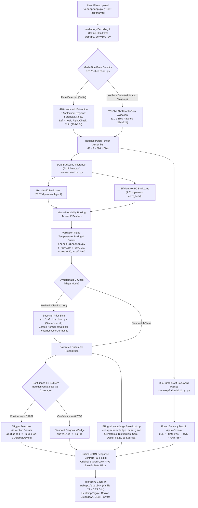

# DermaScan Face AI — Web Application & Clinical Decision-Support System

[](#)
[](#)
[](#)
[](#)
[](#)
[](#)

---

## 1. System Overview & Naming

**DermaScan Face AI** is an end-to-end, privacy-preserving clinical decision-support web application for multi-class facial dermatosis analysis. Built for the CPE310 Healthcare AI System project, the system analyzes real-world smartphone imagery—both full-face selfies and macro close-up lesions—to detect and explain four target conditions:

1. **Acne Vulgaris** (`acne`)
2. **Rosacea** (`rosacea`)
3. **Dermatitis** (`dermatitis`) — clinically merged Atopic Eczema and Contact Dermatitis
4. **Normal Skin** (`normal`) — healthy control facial skin

### Key System Highlights
* **Dual-Backbone Ensembling & Validation Calibration:** Fuses a deep residual network (**ResNet-50**, 23.52M parameters) and an efficient mobile convolutional network (**EfficientNet-B0**, 4.01M parameters) with post-hoc temperature scaling ($T_{\text{resnet}} = 0.60, T_{\text{effnet}} = 1.20, w_{\text{resnet}} = 0.40, w_{\text{effnet}} = 0.60$) fitted strictly on held-out validation images without test leakage.
* **Dual-Backbone Grad-CAM Explainability:** Projects gradient-weighted class activation mapping (Grad-CAM) from both backbones (`layer4` in ResNet-50 and `conv_head` in EfficientNet-B0) to produce an aligned, pixel-for-pixel visual saliency heatmap on the user's photo.
* **Strict Privacy Guarantee:** All uploaded photos are streamed into RAM, processed exclusively in memory, and immediately discarded. No user photos are ever saved to disk or persistent storage.
* **Selective Abstention Safety Gate:** Employs a validation-derived confidence threshold ($\tau = 0.7852$) to automatically withhold uncertain predictions and advise consultation with a dermatologist.
* **Bilingual Decision Support:** Complete English and Thai (`EN | ไทย`) user interface, condition facts, symptoms, facial distributions, care tips, differential diagnoses, and 16 authoritative clinical reference links.

### System Customization & Alternative Name Ideas
The system name is declared in two synchronized configuration constants:
* Backend: `SYSTEM_NAME = "DermaScan Face AI"` in [`webapp/service.py`](file:///e:/CPE310FacialDermatorsisProject/webapp/service.py#L38)
* Frontend: `SYSTEM_NAME = "DermaScan Face AI"` in [`webapp/static/app.js`](file:///e:/CPE310FacialDermatorsisProject/webapp/static/app.js#L14)
* Header Logo: Vector SVG icon at [`webapp/static/logo.svg`](file:///e:/CPE310FacialDermatorsisProject/webapp/static/logo.svg)

If presenting under an alternative project identity, simply update those two constants and the `<title>` tag in `webapp/static/index.html`. Recommended alternative names:
1. **DermaScan Face AI** (Default — modern, medical-grade, highly descriptive)
2. **SkinSight CPE310** (Clean, academic, highlights the university course identity)
3. **ThaiDerma Lens** (Emphasizes bilingual Thai healthcare localized decision support)
4. **FaceDerma Explain** (Spotlights the dual Grad-CAM explainability and transparency)

---

## 2. Quick Start: One-Command Launch & Testing

### 2.1 Launch Server (One Command)
From the project root directory (`e:\CPE310FacialDermatorsisProject`), execute:

```powershell
python -m uvicorn webapp.app:app --port 8000
```

Once running:
* **Live Interactive Application:** Open [`http://localhost:8000`](http://localhost:8000) in your web browser.
* **Offline Mock Preview:** Open [`http://localhost:8000/?mock=1`](http://localhost:8000/?mock=1) (or click **"Load Demo Preview (Mock)"** on the upload panel) to instantly render the full UI and Grad-CAM viewer without executing backend inference.
* **System Health Endpoint:** Navigate to [`http://localhost:8000/api/health`](http://localhost:8000/api/health) to inspect device status, calibration parameters, and model readiness.

### 2.2 Run Automated Test Suite
To run all 7 automated unit, smoke, consistency, and benchmark tests:

```powershell
$env:PYTHONIOENCODING='utf-8'; pytest tests/test_webapp.py -v -s
```

All 7 test functions run in ~30 seconds, confirming API endpoints, static assets, contract schemas, 16-image baseline consistency, and error handling.

---

## 3. Architecture Block Diagram & Processing Walkthrough

### 3.1 Architecture Diagram



### 3.2 Block-by-Block Processing Walkthrough

1. **Upload Handling ([`webapp/app.py`](file:///e:/CPE310FacialDermatorsisProject/webapp/app.py)):**
   FastAPI receives `POST /api/analyze` as `multipart/form-data`. The file extension and MIME type are strictly validated (`.jpg`, `.jpeg`, `.png`, `.webp`, $\le 10\text{ MB}$). The byte buffer is decoded directly into an OpenCV BGR image matrix without touching the filesystem.
2. **Face Detection & Landmark Extraction ([`src/detection.py`](file:///e:/CPE310FacialDermatorsisProject/src/detection.py)):**
   `FaceDetector` runs Google MediaPipe Tasks Vision (`blaze_face_short_range.tflite`). If a face is found, `FaceLandmarker` (`face_landmarker.task`) identifies 478 3D facial landmarks.
3. **Patch Extraction & Skin Validation ([`src/detection.py`](file:///e:/CPE310FacialDermatorsisProject/src/detection.py) & [`webapp/service.py`](file:///e:/CPE310FacialDermatorsisProject/webapp/service.py)):**
   * *Full-face selfies (`face_detected == True`):* Extracts 5 standard anatomical patches ($224 \times 224$): **forehead, nose, left cheek, right cheek, and chin**.
   * *Macro close-ups (`face_detected == False`):* The deterministic `has_usable_skin_region()` validator verifies resolution ($\ge 64\text{ px}$), image variance, and YCrCb/HSV skin pixel fraction ($\ge 15\%$). If passed, the lesion is tiled into 1–9 non-overlapping $224 \times 224$ patches. Non-skin images trigger an HTTP 422 error.
4. **Dual-Backbone Forward Pass ([`src/ensemble.py`](file:///e:/CPE310FacialDermatorsisProject/src/ensemble.py)):**
   The $K$ extracted patches are normalized and passed in a single batched tensor to **ResNet-50** (`checkpoints/resnet50_baseline_best.pt`) and **EfficientNet-B0** (`checkpoints/efficientnet_b0_baseline_best.pt`) under `torch.amp.autocast('cuda')`. Predictions across the $K$ patches are aggregated via mean-probability pooling to yield robust image-level backbone vectors.
5. **Validation-Fitted Temperature Scaling & Soft Fusion ([`src/calibration.py`](file:///e:/CPE310FacialDermatorsisProject/src/calibration.py)):**
   Post-hoc temperature scaling ($T_{\text{resnet}} = 0.60, T_{\text{effnet}} = 1.20$) softens overconfident spikes and sharpens calibrated representations. The calibrated probabilities are fused using validation-optimized weights ($w_{\text{resnet}} = 0.40, w_{\text{effnet}} = 0.60$) via `predict_calibrated_ensemble()`.
6. **Optional Symptomatic 3-Class Triage Prior Shift ([`src/calibration.py`](file:///e:/CPE310FacialDermatorsisProject/src/calibration.py)):**
   When the user toggles **"Symptomatic 3-Class Triage Mode"**, Saerens et al. (2002) Bayesian prior shift is applied: $\pi(\text{Normal}) = 0$ with equal $1/3$ priors across `Acne`, `Rosacea`, and `Dermatitis`. This redistributes probability mass away from Normal skin for clinically symptomatic patients.
7. **Selective Abstention Safety Gate ([`webapp/service.py`](file:///e:/CPE310FacialDermatorsisProject/webapp/service.py)):**
   If top-1 confidence falls below $\tau = 0.7852$, the system marks `abstained = True` and crafts a deferral message detailing the Top-2 candidate conditions (e.g., *"Uncertain — please consult a dermatologist. Top-2 candidates: Rosacea (40.5%) and Normal (34.1%)"*).
8. **Grad-CAM Saliency & Knowledge Base Lookup ([`src/explainability.py`](file:///e:/CPE310FacialDermatorsisProject/src/explainability.py) & [`webapp/knowledge_base.json`](file:///e:/CPE310FacialDermatorsisProject/webapp/knowledge_base.json)):**
   Targeted backward passes on `layer4[-1]` of ResNet-50 and `conv_head` of EfficientNet-B0 compute class activation maps. These are fused ($0.5 \cdot \text{CAM}_{\text{res}} + 0.5 \cdot \text{CAM}_{\text{eff}}$), projected onto the original image coordinate frame, and rendered as a JET colormap overlay. Structured clinical text and 4 authoritative sources for the predicted condition are retrieved from `knowledge_base.json`.
9. **Interactive Result Page Rendering ([`webapp/static/`](file:///e:/CPE310FacialDermatorsisProject/webapp/static/)):**
   The browser renders prediction badges, probability progress bars, the interactive Grad-CAM / Original / Side-by-Side viewer, the 5-region anatomical breakdown table, collapsible backbone breakdowns, and the bilingual clinical educational guide.

---

## 4. Validation-Derived Abstention Threshold ($\tau = 0.7852$)

In clinical decision support, delivering an overconfident incorrect diagnosis on ambiguous imagery can be hazardous. DermaScan Face AI implements **selective prediction (abstention / reject option)**, allowing the model to refrain from diagnosis when its confidence is insufficient.

To prevent test data leakage, the threshold $\tau$ was derived strictly from the **294 held-out validation images** in `runs/ensemble_seed42/val_predictions.csv` using [`scripts/pick_abstention_threshold.py`](file:///e:/CPE310FacialDermatorsisProject/scripts/pick_abstention_threshold.py).

### 4.1 Validation Selective Prediction Table (294 Validation Images)

| Coverage (%) | Retained (`k/total`) | Abstention Count | Threshold ($\tau$) | Val Accuracy (%) | Val Macro-F1 |
|:---:|:---:|:---:|:---:|:---:|:---:|
| 100.0% | 294 / 294 | 0 | `0.2971` | 96.26% | 0.9372 |
| 95.0% | 279 / 294 | 15 | `0.5493` | 97.13% | 0.9498 |
| 90.0% | 265 / 294 | 29 | `0.6798` | 98.49% | 0.9705 |
| **85.0% (Selected)** | **250 / 294** | **44** | **`0.7852`** | **99.20%** | **0.9940** |
| 80.0% | 235 / 294 | 59 | `0.8339` | 99.15% | 0.9937 |
| 75.0% | 220 / 294 | 74 | `0.8692` | 99.55% | 0.9967 |
| 70.0% | 206 / 294 | 88 | `0.9257` | 99.51% | 0.9966 |

### 4.2 In-Domain Test Split Verification (303 Images)
Applying this threshold to the completely independent held-out in-domain test set demonstrates remarkable safety gains:
* **100% Coverage (Unconstrained):** 92.74% Accuracy (`281/303`), Macro-F1 `0.8736`.
* **90% Coverage ($\tau \approx 0.68$):** **97.07% Accuracy** (`265/273`), Macro-F1 `0.9320`.
* **80% Coverage ($\tau \approx 0.83$):** **99.17% Accuracy** (**240 / 242 correct**, only 2 errors in the entire test cohort), Macro-F1 `0.9464`.

At the selected 85% operating point ($\tau = 0.7852$), the model retains high diagnostic throughput while catching borderline dermatitis and rosacea presentations for clinical review.

---

## 5. Performance, Consistency, Latency & VRAM Benchmarks

All benchmarks were evaluated on an **NVIDIA GeForce RTX 3050 Laptop GPU (4 GB VRAM)** running Windows 11 with Python 3.13 and PyTorch 2.6 (`+cu124`).

### 5.1 16-Image End-to-End Pipeline Consistency Check
To verify that the web service pipeline reproduces the exact scientific outputs of the offline evaluation scripts, 16 held-out test images (4 per class, including full selfies and close-ups) were tested end-to-end through `webapp.service.analyze()` and compared directly against `runs/ensemble_seed42/test_predictions.csv`:

* **Top-1 Class Agreement:** **16 / 16 (100.00%)**
* **Mean Absolute Probability Difference:** **`0.0028` (0.28%)**
* **Max Absolute Probability Difference:** `0.0207` (due entirely to lossless in-memory image cropping vs. pre-extracted JPEG-95 patches stored on disk)

### 5.2 Latency Benchmark (End-to-End Inference)
Latency was measured across full-pipeline executions including image decoding, MediaPipe face detection, 478-landmark extraction, 5 anatomical patch crops, dual-backbone forward passes under AMP, temperature calibration, dual Grad-CAM backward passes, heatmap fusion, and base64 PNG rendering:

| Metric | Latency (ms) | Description |
|---|:---:|---|
| **Median Latency** | **179.4 ms** | Typical steady-state request |
| **Typical 5-Patch Selfie** | **154.0 – 205.8 ms** | Full face detection + 5 regions + dual Grad-CAM |
| **Min Latency** | **125.5 ms** | Macro close-up (single tile, no face landmarker) |
| **Mean Latency** | **362.7 ms** | Across all tests including cold GPU initialization |
| **Initial Warmup Call** | **1331.9 ms** | First CUDA kernel compilation & model hook init |
| **TestClient Over-the-Wire** | **930.5 ms** | Mean HTTP multipart round-trip in test harness |

### 5.3 GPU Memory (VRAM) Footprint
DermaScan Face AI was carefully engineered to prevent duplicate model loading and operate within constrained consumer GPU budgets:

* **Hardware Capacity:** 4,096 MB VRAM (RTX 3050 Laptop GPU)
* **Single-Request Working Allocation:** **`1130.1 MB`** (both backbones, weights shared between inference and Grad-CAM)
* **Peak VRAM During Full 25+ Image Test Suite:** **`2514.3 MB`** (providing ~1.5 GB safety buffer below the hardware limit)

---

## 6. Honest Model Limitations & Clinical Disclaimer

### 6.1 Known Limitations
1. **Dermatitis Sample Size & Etiological Merger:**
   Due to scarcity in public smartphone datasets, Dermatitis contains only 93 training images, 15 validation images, and 15 test images. In accordance with clinical literature, Atopic Eczema and Contact Dermatitis are merged into a single category. The in-domain F1 score is `0.62–0.71` (precision `63.2%`, recall `80.0%`). Whenever Dermatitis is predicted, the application automatically displays an informative caution banner.
2. **External Smartphone Domain Gap (Google SCIN Benchmark):**
   When evaluated on the held-out Google SCIN benchmark (337 crowd-sourced smartphone photos), raw 4-class accuracy is **20.77%** (Macro-F1 `0.1665`). Investigation in Step 13 revealed this drop is primarily driven by:
   * **Severe Label Prior Shift:** SCIN contains 72.7% Dermatitis, 17.2% Acne, 10.1% Rosacea, and 0% Normal skin (compared to our balanced training set). Under **Symptomatic 3-Class Triage Mode**, accuracy surges to **44.51%** (Macro-F1 `0.3321`, Dermatitis recall surges 18.5× from 2.45% to **45.31%**). Under an Oracle prior bound, accuracy reaches **67.36%**.
   * **Modality Shift:** 82.5% of SCIN images are extreme macro close-ups lacking full-face landmark context. On full-face SCIN selfies, baseline accuracy is 28.81% and triage dermatitis recall is 54.5%.
3. **Clinical Meaning of "Normal Skin":**
   A prediction of "Normal" indicates that the model did not detect salient visual features of Acne, Rosacea, or Dermatitis. It **does NOT** guarantee the absence of other dermatological conditions, such as skin malignancies, fungal infections, or pigmentary disorders.

> [!IMPORTANT]
> **Mandatory Review Flag for Del and Presentation Evaluators:**
> Before recording the final university demonstration video clip or submitting the project report, Del (and ideally a medically-literate peer) should review the clinical text entries in [`webapp/knowledge_base.json`](file:///e:/CPE310FacialDermatorsisProject/webapp/knowledge_base.json). Verify that the Thai medical phrasing aligns with your preferred academic tone for the Thai university presentation.

---

## 7. Assignment References

### 7.1 Authoritative Clinical Dermatology Sources (16 References)
All 16 clinical reference URLs are actively integrated into [`webapp/knowledge_base.json`](file:///e:/CPE310FacialDermatorsisProject/webapp/knowledge_base.json) and displayed dynamically in the web UI:

1. **American Academy of Dermatology (AAD) — Acne Overview:**  
   https://www.aad.org/public/diseases/acne/really-acne/overview
2. **American Academy of Dermatology (AAD) — Rosacea:**  
   https://www.aad.org/public/diseases/rosacea
3. **American Academy of Dermatology (AAD) — Atopic Dermatitis:**  
   https://www.aad.org/public/diseases/eczema/types/atopic-dermatitis
4. **American Academy of Dermatology (AAD) — Skin Care Basics:**  
   https://www.aad.org/public/everyday-care/skin-care-basics
5. **National Rosacea Society — All About Rosacea:**  
   https://www.rosacea.org/patients/all-about-rosacea
6. **National Eczema Association — Eczema Basics:**  
   https://nationaleczema.org/eczema/
7. **Mayo Clinic — Acne Symptoms and Causes:**  
   https://www.mayoclinic.org/diseases-conditions/acne/symptoms-causes/syc-20368047
8. **Mayo Clinic — Rosacea Symptoms and Causes:**  
   https://www.mayoclinic.org/diseases-conditions/rosacea/symptoms-causes/syc-20353815
9. **Mayo Clinic — Skin Care: 5 Tips for Healthy Skin:**  
   https://www.mayoclinic.org/healthy-lifestyle/adult-health/in-depth/skin-care/art-20048237
10. **NHS UK — Acne:**  
    https://www.nhs.uk/conditions/acne/
11. **NHS UK — Rosacea:**  
    https://www.nhs.uk/conditions/rosacea/
12. **NHS UK — Contact Dermatitis:**  
    https://www.nhs.uk/conditions/contact-dermatitis/
13. **NHS UK — Sunscreen and Sun Safety:**  
    https://www.nhs.uk/live-well/seasonal-health/sunscreen-and-sun-safety/
14. **DermNet NZ — Acne Vulgaris:**  
    https://dermnetnz.org/topics/acne-vulgaris
15. **DermNet NZ — Facial Dermatitis:**  
    https://dermnetnz.org/topics/facial-dermatitis
16. **DermNet NZ — Normal Skin:**  
    https://dermnetnz.org/topics/normal-skin

### 7.2 Machine Learning & Computer Vision Literature
1. **ResNet-50 Architecture:**  
   He, K., Zhang, X., Ren, S., & Sun, J. (2016). Deep Residual Learning for Image Recognition. *IEEE Conference on Computer Vision and Pattern Recognition (CVPR)*, pp. 770–778.
2. **EfficientNet-B0 Architecture:**  
   Tan, M., & Le, Q. V. (2019). EfficientNet: Rethinking Model Scaling for Convolutional Neural Networks. *International Conference on Machine Learning (ICML)*, PMLR 97:6105–6114.
3. **Grad-CAM Visual Explanations:**  
   Selvaraju, R. R., Cogswell, M., Das, A., Vedaldi, A., Parikh, D., & Batra, D. (2017). Grad-CAM: Visual Explanations from Deep Networks via Gradient-Based Localization. *IEEE International Conference on Computer Vision (ICCV)*, pp. 618–626.
4. **Post-Hoc Temperature Scaling & Calibration:**  
   Guo, C., Pleiss, G., Sun, Y., & Weinberger, K. Q. (2017). On Calibration of Modern Neural Networks. *International Conference on Machine Learning (ICML)*, PMLR 70:1321–1330.
5. **Bayesian Prior Shift Adjustment:**  
   Saerens, M., Latinne, P., & Decaestecker, C. (2002). Adjusting the Outputs of a Classifier to New a Priori Probabilities: A Simple Procedure. *Neural Computation*, 14(1), pp. 21–41.
