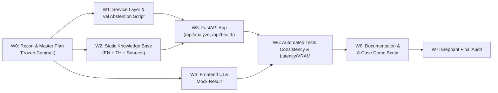

# Elephant Master Plan: Demo Web Application (`webapp/`)

**Architecture Methodology:** Elephant & Goldfish  
- **Elephant (Planner / Architect):** Performs codebase recon (Task W0), freezes the API and Knowledge Base contracts, writes self-contained Goldfish specs (`tasks/task_w1_*.md` through `tasks/task_w6_*.md`), verifies each Goldfish handoff report, and conducts the final audit (Task W7).
- **Goldfish (Stateless Worker Agent):** Executes a single self-contained task specification file, runs acceptance checks, writes `tasks/task_w<N>_handoff_report.md`, and stops.
- **Del (Human Relay):** Launches Goldfish sessions, pastes launch prompts, and relays handoff reports back to the Elephant.

---

## 1. Task Status & Dependency Graph



| ID | Task | Depends on | Deliverable(s) | Spec File | Report File | Status |
|---|---|---|---|---|---|---|
| **W0** | Elephant recon, master plan, frozen API & KB contracts | none | `tasks/WEBAPP_MASTER_PLAN.md` | — | — | **DONE** |
| **W1** | Service layer (`WebAppDermatosisService`, `analyze`) + val-split abstention threshold script | W0 | `scripts/pick_abstention_threshold.py`, `webapp/__init__.py`, `webapp/service.py` | `tasks/task_w1_service_layer.md` | `tasks/task_w1_handoff_report.md` | **DONE** (`tau=0.7852`, VRAM `1130.1 MB`) |
| **W2** | Bilingual (EN + TH) static condition knowledge base with reputable medical sources | W0 | `webapp/knowledge_base.json` | `tasks/task_w2_knowledge_base.md` | `tasks/task_w2_handoff_report.md` | **DONE** (4 classes, EN+TH, 16 sources) |
| **W3** | FastAPI app with lifespan model loading, `/api/analyze`, `/api/health`, validation, static serving | W1, W2 | `webapp/app.py`, `requirements.txt` (updated) | `tasks/task_w3_fastapi_app.md` | `tasks/task_w3_handoff_report.md` | **DONE** (All routes & error codes verified) |
| **W4** | Responsive frontend (EN/TH toggle, heatmap toggle, region table, probability bars, model breakdown, abstention banner, limitations panel) + mock JSON + SVG logo | W0 | `webapp/static/index.html`, `webapp/static/style.css`, `webapp/static/app.js`, `webapp/static/mock_result.json`, `webapp/static/logo.svg` | `tasks/task_w4_frontend.md` | `tasks/task_w4_handoff_report.md` | **DONE** (5 static files verified) |
| **W5** | Automated test suite (`TestClient` smoke tests, 20-image CSV consistency check, latency & peak VRAM benchmark) | W3, W4 | `tests/test_webapp.py` | `tasks/task_w5_tests_and_benchmarks.md` | `tasks/task_w5_handoff_report.md` | **DONE** (`7 passed`, 16/16 consistency `0.0028` diff, median `179.4 ms`) |
| **W6** | Documentation (`WEBAPP_README.md`, `DEMO_SCRIPT.md` covering all 8 demo cases with real test-split paths, architecture diagram) | W5 | `WEBAPP_README.md`, `DEMO_SCRIPT.md` | `tasks/task_w6_docs_and_demo_script.md` | `tasks/task_w6_handoff_report.md` | **DONE** (`WEBAPP_README.md` + `DEMO_SCRIPT.md` verified) |
| **W7** | Elephant final audit across all 8 demo cases and project rules | W6 | `tasks/webapp_final_audit.md` | — | `tasks/webapp_final_audit.md` | **DONE** (All 8 demo cases, 7 test suites, & rules verified) |

> [!TIP]
> **Parallel Execution Ready:** Tasks **W1**, **W2**, and **W4** depend only on **W0** and touch completely disjoint files. Del can run W1, W2, and W4 in parallel or in any order.

---

## 2. Recon Findings: Real Function Signatures in `src/`

Verified by reading `src/dataset.py`, `src/detection.py`, `src/model.py`, `src/ensemble.py`, `src/calibration.py`, `src/explainability.py`, `src/inference.py`, and `scripts/analyze_scin_domain_gap.py`:

### 2.1 `src/dataset.py`
- `CLASS_NAMES: List[str] = ["Acne", "Rosacea", "Dermatitis", "Normal"]` (Note: Title Case in `src/`; mapped to lowercase `"acne"`, `"rosacea"`, `"dermatitis"`, `"normal"` in API JSON keys).
- `CLASS_TO_IDX: Dict[str, int] = {"Acne": 0, "Rosacea": 1, "Dermatitis": 2, "Normal": 3}`
- `IDX_TO_CLASS: Dict[int, str] = {0: "Acne", 1: "Rosacea", 2: "Dermatitis", 3: "Normal"}`
- `NUM_CLASSES: int = 4`
- `get_eval_transforms(img_size: int = 224) -> transforms.Compose`: Accepts a `uint8` RGB numpy array `(H, W, 3)` and returns a normalized `float32` tensor `(3, 224, 224)`.

### 2.2 `src/detection.py`
- `FaceDetector(model_path: Optional[Path] = None, min_detection_confidence: float = 0.5)`:
  - `.detect(image_or_path: Any, max_dim: int = 1280) -> Dict[str, Any]`
  - Returns `{"face_detected": bool, "face_conf": Optional[float], "face_area_frac": Optional[float], "bbox": Optional[Tuple[int, int, int, int]], "keypoints": Optional[List[Tuple[float, float]]]}`.
  - `.close() -> None`
- `FaceLandmarker(model_path: Optional[Path] = None)`:
  - `.detect_landmarks(image_bgr: np.ndarray) -> Optional[List[Tuple[float, float, float]]]`
  - `.close() -> None`
- `extract_face_patches(image_bgr: np.ndarray, detection_info: Optional[Dict[str, Any]] = None, landmarker: Optional[FaceLandmarker] = None, target_size: int = 224) -> Dict[str, Any]`:
  - Returns `{"patches": Dict[str, np.ndarray], "boxes": Dict[str, Tuple[int, int, int, int]]}` for keys `["forehead", "nose", "left_cheek", "right_cheek", "chin"]`.
- `extract_tile_patches(image_bgr: np.ndarray, target_size: int = 224, max_tiles: int = 9) -> Dict[str, Any]`:
  - Returns `{"patches": List[np.ndarray], "boxes": List[Tuple[int, int, int, int]], "image_tiled": np.ndarray}`.

### 2.3 `src/ensemble.py`
- `DEFAULT_RESNET_CHECKPOINT = PROJECT_ROOT / "checkpoints" / "resnet50_baseline_best.pt"`
- `DEFAULT_EFFNET_CHECKPOINT = PROJECT_ROOT / "checkpoints" / "efficientnet_b0_baseline_best.pt"`
- `DermatosisEnsemble(resnet_checkpoint=DEFAULT_RESNET_CHECKPOINT, effnet_checkpoint=DEFAULT_EFFNET_CHECKPOINT, weights=(0.5, 0.5), device=None)`:
  - `.resnet`: `DermatosisClassifier` (`resnet50`)
  - `.effnet`: `DermatosisClassifier` (`efficientnet_b0`)
  - `.predict_patches(x: torch.Tensor) -> Dict[str, torch.Tensor]`: runs under `@torch.no_grad()` and `torch.amp.autocast(device_type)`. Returns `{"ensemble_probs": Tensor(K, 4), "resnet_probs": Tensor(K, 4), "effnet_probs": Tensor(K, 4)}`.
  - `.predict_image_from_patches(x: torch.Tensor, aggregation: str = "mean") -> Dict[str, Any]`:
    Returns:
    - `"ensemble_probs"`: `Tensor(4,)`
    - `"resnet_probs"`: `Tensor(4,)` (mean-pooled across K patches)
    - `"effnet_probs"`: `Tensor(4,)` (mean-pooled across K patches)
    - `"pred_idx"`, `"predicted_class"`, `"resnet_pred_idx"`, `"resnet_predicted_class"`, `"effnet_pred_idx"`, `"effnet_predicted_class"`, `"models_agree"`
    - `"ensemble_patch_probs"`: `Tensor(K, 4)`
    - `"resnet_patch_probs"`: `Tensor(K, 4)`
    - `"effnet_patch_probs"`: `Tensor(K, 4)`

### 2.4 `src/calibration.py`
- `temperature_scale_probs(probs: np.ndarray, temperature: float, eps: float = 1e-12) -> np.ndarray`:
  Scales probabilities in log-space: `logits = np.log(np.maximum(probs, eps)) / float(temperature)` followed by softmax along last axis. Works on 1D `(4,)` or 2D `(K, 4)` arrays!
- `predict_calibrated_ensemble(res_probs: np.ndarray, eff_probs: np.ndarray, w_resnet: float, t_resnet: float, t_effnet: float) -> np.ndarray`:
  Applies `temperature_scale_probs(res_probs, t_resnet)` and `temperature_scale_probs(eff_probs, t_effnet)` and returns `w_resnet * scaled_res + (1 - w_resnet) * scaled_eff` normalized to sum to 1 along the last axis. Works on `(1, 4)` or `(K, 4)` arrays!
- `apply_bayes_prior_adjustment(probs: np.ndarray, source_priors: np.ndarray, target_priors: np.ndarray, eps: float = 1e-12) -> np.ndarray`:
  Requires `probs` of shape `(N, C)` (2D!). Multiplies by `target_priors / source_priors` where `target_priors > 0` (zeroes out classes where `target_priors == 0`) and re-normalizes each row.
- `evaluate_selective_prediction(probs: np.ndarray, targets: np.ndarray, coverages: Optional[List[float]] = None, uncertainty_metric: str = "confidence") -> List[Dict[str, Any]]`:
  Returns list of dicts `{"coverage": float, "k": int, "total": int, "threshold": float, "accuracy": float, "macro_f1": float, "abstention_count": int}`.

### 2.5 `src/explainability.py`
- `get_target_layers(classifier: Union[DermatosisClassifier, nn.Module]) -> List[nn.Module]`:
  Returns `[backbone.layer4[-1]]` for ResNet-50 and `[backbone.conv_head]` for EfficientNet-B0.
- `DermatosisExplainer(resnet_checkpoint=DEFAULT_RESNET_CHECKPOINT, effnet_checkpoint=DEFAULT_EFFNET_CHECKPOINT, device=None)`:
  - Loads `self.resnet` and `self.effnet` with `requires_grad_(True)`, creates `self.cam_resnet = GradCAM(...)` and `self.cam_effnet = GradCAM(...)`.
  - `.explain_patch_batch(patch_tensors: torch.Tensor, patch_rgb_floats: List[np.ndarray], target_class_idx: Optional[int] = None, patch_names: Optional[List[str]] = None) -> Dict[str, Any]`:
    Computes `resnet_cams`, `effnet_cams`, and fused `ens_cams` (`0.5 * resnet_cams[k] + 0.5 * effnet_cams[k]` normalized to `[0, 1]`), plus `patch_attributions` and `dominant_patch`.
  - `.close() -> None`: Releases Grad-CAM hooks and MediaPipe detectors.

---

## 3. Contradictions & Gaps Identified in `WEBAPP_HANDOFF_PROMPT.md` (and Resolutions)

1. **Class Name Casing (`"Rosacea"` vs `"rosacea"`):**
   - *Gap:* `src/dataset.py` uses Title Case (`["Acne", "Rosacea", "Dermatitis", "Normal"]`), whereas Section 3 & Section 4 of `WEBAPP_HANDOFF_PROMPT.md` use lowercase (`"acne"`, `"rosacea"`, `"dermatitis"`, `"normal"`) for JSON keys and `knowledge_base.json`.
   - *Resolution:* Freeze API JSON keys and `knowledge_base.json` keys as **lowercase** (`"acne"`, `"rosacea"`, `"dermatitis"`, `"normal"`), and also include `"prediction_label"` in Title Case (`"Acne"`, `"Rosacea"`, `"Dermatitis"`, `"Normal"`).
2. **Duplicate GPU Model Loading (`DermatosisEnsemble` vs `DermatosisExplainer`):**
   - *Gap:* Instantiating both `FacialDermatosisPredictor(ensemble=True)` and `DermatosisExplainer()` independently loads **two copies** of ResNet-50 and EfficientNet-B0 onto the 4 GB RTX 3050 GPU and two sets of MediaPipe detectors.
   - *Resolution:* In `webapp/service.py`, `WebAppDermatosisService` instantiates `DermatosisEnsemble` **once** for inference, enables `requires_grad_(True)` on its `.resnet` and `.effnet` backbones only during the Grad-CAM pass, and attaches `GradCAM` directly to those same backbone instances (or shares them with `DermatosisExplainer`). Only **1 copy** of each model resides in VRAM.
3. **Temperature Scaling Application Order & `test_predictions.csv` Consistency:**
   - *Gap:* `runs/ensemble_seed42/test_predictions.csv` stores **uncalibrated** (`T=1.0, w=0.50`) probabilities in `ens_equal_prob_<Class>`, alongside raw per-backbone image-level mean probabilities `resnet_prob_<Class>` and `effnet_prob_<Class>`. Step 13 (`scripts/analyze_scin_domain_gap.py`) applies temperature scaling (`T_resnet=0.60, T_effnet=1.20, w_resnet=0.40`) via `predict_calibrated_ensemble` on the **image-level mean probabilities** `r_img_probs` and `e_img_probs`.
   - *Resolution:* `webapp/service.py` computes patch probabilities via `ensemble.predict_image_from_patches(stacked_tensors, aggregation="mean")` (under `torch.amp.autocast`), then applies `predict_calibrated_ensemble` (`T_resnet=0.60, T_effnet=1.20, w_resnet=0.40`) to the image-level `resnet_probs` and `effnet_probs` (and also to each patch's probabilities for `region_probabilities`). In W5's consistency test against `test_predictions.csv`, both raw per-backbone probabilities and calibrated ensemble probabilities derived from `test_predictions.csv` are verified.
4. **Validation-Split Abstention Threshold Not Pre-Computed in Step 13 Report:**
   - *Gap:* Step 13 (`data/reports/step13_scin_domain_gap_report.md`) tabulated selective prediction thresholds only for `test` and `scin`, not `val`. Section 3 of `WEBAPP_HANDOFF_PROMPT.md` strictly requires deriving the abstention threshold from the **validation split** (targeting 80–90% val coverage).
   - *Resolution:* In W1, `scripts/pick_abstention_threshold.py` loads `runs/ensemble_seed42/val_predictions.csv`, computes the calibrated ensemble probabilities (`T_resnet=0.60, T_effnet=1.20, w_resnet=0.40`), runs `evaluate_selective_prediction` across coverages `[1.00, 0.95, 0.90, 0.85, 0.80, 0.75, 0.70]`, and selects the **85% validation coverage threshold** (midpoint of 80–90%) as `ABSTENTION_THRESHOLD` in `webapp/service.py`.
5. **Case 8 ("Image with no face and no usable skin region -> friendly message"):**
   - *Gap:* `src/detection.py`'s `extract_tile_patches` unconditionally tiles *any* non-face image (even a solid black image, a text screenshot, or a landscape photo) into 1–9 tiles without checking for skin pixels.
   - *Resolution:* In `webapp/service.py`, when `face_detected == False`, run a deterministic `has_usable_skin_region(img_bgr)` check (verifying minimum resolution `min(h, w) >= 64`, grayscale standard deviation `>= 8.0`, and broad YCrCb/HSV human-skin + erythema pixel fraction `>= 0.15` covering Fitzpatrick I–VI and inflamed skin). If it fails, raise `UnusableImageError(error_code="no_skin_detected")`, which `/api/analyze` returns as HTTP `422` with a friendly bilingual message.
6. **System Name & Logo Placeholder:**
   - *Resolution:* Use `SYSTEM_NAME = "DermaScan Face AI"` in `webapp/service.py` and `webapp/static/app.js`, and create a clean medical-themed vector logo at `webapp/static/logo.svg` (plus a generated `webapp/static/logo.png` fallback).

---

## 4. Frozen Contracts (DO NOT ALTER IN GOLDFISH TASKS)

### 4.1 Frozen Constants (`webapp/service.py`)
```python
SYSTEM_NAME: str = "DermaScan Face AI"
CALIBRATION_T_RESNET: float = 0.60
CALIBRATION_T_EFFNET: float = 1.20
CALIBRATION_W_RESNET: float = 0.40
CALIBRATION_W_EFFNET: float = 0.60
# Derived strictly from val_predictions.csv at 85% coverage by scripts/pick_abstention_threshold.py:
ABSTENTION_THRESHOLD: float = 0.7852  # (Exact float from val 85.0% coverage; Val Acc 99.20%, Val Macro-F1 0.9940)
TRAINING_SOURCE_PRIORS: List[float] = [591 / 1617, 466 / 1617, 63 / 1617, 497 / 1617]  # Acne, Rosacea, Dermatitis, Normal
TRIAGE_TARGET_PRIORS: List[float] = [1.0 / 3.0, 1.0 / 3.0, 1.0 / 3.0, 0.0]
MAX_UPLOAD_BYTES: int = 10 * 1024 * 1024  # 10 MB
ALLOWED_MIME_TYPES: Set[str] = {"image/jpeg", "image/jpg", "image/png", "image/webp"}
ALLOWED_EXTENSIONS: Set[str] = {".jpg", ".jpeg", ".png", ".webp"}
FACE_REGIONS: List[str] = ["forehead", "nose", "left_cheek", "right_cheek", "chin"]
```

### 4.2 Frozen `/api/analyze` Response Contract (`200 OK`)
Endpoint: `POST /api/analyze`  
Content-Type: `multipart/form-data` with `file` (`UploadFile`) and optional `triage_mode` (`bool = False`).

```json
{
  "prediction": "rosacea",
  "prediction_label": "Rosacea",
  "confidence": 0.9124,
  "abstained": false,
  "abstention_threshold": 0.8548,
  "abstention_message": null,
  "caution_note": null,
  "triage_mode": false,
  "probabilities": {
    "acne": 0.0412,
    "rosacea": 0.9124,
    "dermatitis": 0.0281,
    "normal": 0.0183
  },
  "top2": ["rosacea", "acne"],
  "input_mode": "face",
  "face_detected": true,
  "num_patches": 5,
  "dominant_region": "left_cheek",
  "region_probabilities": {
    "forehead": {"acne": 0.081, "rosacea": 0.842, "dermatitis": 0.045, "normal": 0.032},
    "nose": {"acne": 0.032, "rosacea": 0.931, "dermatitis": 0.021, "normal": 0.016},
    "left_cheek": {"acne": 0.029, "rosacea": 0.945, "dermatitis": 0.018, "normal": 0.008},
    "right_cheek": {"acne": 0.034, "rosacea": 0.928, "dermatitis": 0.024, "normal": 0.014},
    "chin": {"acne": 0.03, "rosacea": 0.916, "dermatitis": 0.0325, "normal": 0.0215}
  },
  "model_breakdown": {
    "resnet50": {
      "prediction": "rosacea",
      "confidence": 0.931,
      "probabilities": {"acne": 0.031, "rosacea": 0.931, "dermatitis": 0.022, "normal": 0.016}
    },
    "efficientnet_b0": {
      "prediction": "rosacea",
      "confidence": 0.9,
      "probabilities": {"acne": 0.048, "rosacea": 0.9, "dermatitis": 0.0322, "normal": 0.0198}
    },
    "models_agree": true,
    "calibration_params": {
      "t_resnet": 0.6,
      "t_effnet": 1.2,
      "w_resnet": 0.4,
      "w_effnet": 0.6
    }
  },
  "original_image": "data:image/png;base64,...",
  "gradcam_image": "data:image/png;base64,...",
  "latency_ms": 124.5,
  "info": { ...entry from knowledge_base.json for "rosacea"... },
  "disclaimer": "Educational research demonstration only — NOT a medical diagnosis. Do not use for clinical decision-making. Please consult a qualified dermatologist."
}
```

**Contract Rules for Field Values:**
- `prediction`: lowercase string in `["acne", "rosacea", "dermatitis", "normal"]` (always the top-1 class, even when `abstained` is `true`).
- `prediction_label`: Title Case string in `["Acne", "Rosacea", "Dermatitis", "Normal"]`.
- `confidence`: `float` rounded to 4 decimal places (`probabilities[prediction]`).
- `abstained`: `bool` (`True` if `confidence < abstention_threshold`, else `False`).
- `abstention_message`: `None` if `abstained == False`; otherwise `"Uncertain — please consult a dermatologist. Top-2 candidates: <Top1> (<p1>%) and <Top2> (<p2>%)"`.
- `caution_note`:
  - When `prediction == "dermatitis"`: `"Note: Dermatitis is the smallest class in the training set (93 training / 15 test images; in-domain F1 0.62–0.71) and merges atopic eczema and contact dermatitis. Interpret with extra caution."`
  - When `prediction == "normal"`: `"Note: A 'Normal' result means no strong visual signs of the 3 target conditions (Acne, Rosacea, Dermatitis) were detected. It does NOT guarantee the absence of other skin conditions."`
  - Otherwise `None`.
- `input_mode`: `"face"` when `face_detected == True` (and 5 face patches extracted), `"closeup"` when `face_detected == False`.
- `region_probabilities`: dict of 5 regions (`forehead`, `nose`, `left_cheek`, `right_cheek`, `chin`) mapping to calibrated 4-class probability dicts when `input_mode == "face"`; `None` (`null` in JSON) when `input_mode == "closeup"`.
- `dominant_region`: string name of the patch with the highest mean ensemble Grad-CAM activation (`forehead` / `nose` / `left_cheek` / `right_cheek` / `chin` for face mode, or `tile_0`..`tile_8` for close-up mode).
- `original_image` & `gradcam_image`: PNG data URLs (`"data:image/png;base64,..."`) of the exact same `(cH, cW)` canvas so toggling between Original and Grad-CAM aligns pixel-for-pixel.

### 4.3 Frozen Error Response Contract (`400` / `413` / `415` / `422`)
```json
{
  "detail": "Clear human-readable message in English",
  "detail_th": "ข้อความแจ้งเตือนภาษาไทย",
  "error_code": "invalid_file_type"
}
```
Error codes and HTTP statuses:
- `empty_file` -> HTTP `400`
- `file_too_large` (> 10 MB) -> HTTP `413`
- `invalid_file_type` (unsupported extension or MIME type) -> HTTP `415`
- `unreadable_image` (corrupted bytes / `cv2.imdecode` returns `None`) -> HTTP `400`
- `no_skin_detected` (no face detected AND fails usable skin region check) -> HTTP `422`

### 4.4 Frozen `webapp/knowledge_base.json` Entry Schema
Top-level JSON object has exactly 4 keys: `"acne"`, `"rosacea"`, `"dermatitis"`, `"normal"`.
Each class object contains the 9 flat keys required by Section 4 (in English) **plus** `"en"` and `"th"` sub-objects with identical field names for seamless bilingual UI rendering:
```json
{
  "name": "Rosacea",
  "model_match_phrase": "The model's best match is Rosacea.",
  "short_description": "...",
  "typical_symptoms": ["...", "..."],
  "typical_facial_distribution": "...",
  "common_triggers_or_factors": ["...", "..."],
  "commonly_confused_with": [
    {"condition": "Acne Vulgaris", "how_it_differs": "..."},
    {"condition": "Contact / Seborrheic Dermatitis", "how_it_differs": "..."}
  ],
  "general_care_tips": ["...", "..."],
  "see_a_doctor_if": ["...", "..."],
  "caution_note": null,
  "en": {
    "name": "Rosacea",
    "model_match_phrase": "The model's best match is Rosacea.",
    "short_description": "...",
    "typical_symptoms": ["...", "..."],
    "typical_facial_distribution": "...",
    "common_triggers_or_factors": ["...", "..."],
    "commonly_confused_with": [
      {"condition": "Acne Vulgaris", "how_it_differs": "..."},
      {"condition": "Contact / Seborrheic Dermatitis", "how_it_differs": "..."}
    ],
    "general_care_tips": ["...", "..."],
    "see_a_doctor_if": ["...", "..."],
    "caution_note": null
  },
  "th": {
    "name": "โรคโรซาเซีย (Rosacea)",
    "model_match_phrase": "ผลลัพธ์ที่ใกล้เคียงที่สุดจากโมเดลคือ โรคโรซาเซีย (Rosacea)",
    "short_description": "...",
    "typical_symptoms": ["...", "..."],
    "typical_facial_distribution": "...",
    "common_triggers_or_factors": ["...", "..."],
    "commonly_confused_with": [
      {"condition": "สิว (Acne Vulgaris)", "how_it_differs": "..."},
      {"condition": "โรคผิวหนังอักเสบ (Dermatitis)", "how_it_differs": "..."}
    ],
    "general_care_tips": ["...", "..."],
    "see_a_doctor_if": ["...", "..."],
    "caution_note": null
  },
  "sources": [
    {"title": "American Academy of Dermatology — Rosacea", "url": "https://www.aad.org/public/diseases/rosacea"},
    {"title": "National Rosacea Society — All About Rosacea", "url": "https://www.rosacea.org/patients/all-about-rosacea"},
    {"title": "NHS — Rosacea", "url": "https://www.nhs.uk/conditions/rosacea/"},
    {"title": "Mayo Clinic — Rosacea Symptoms & Causes", "url": "https://www.mayoclinic.org/diseases-conditions/rosacea/symptoms-causes/syc-20353815"}
  ]
}
```
